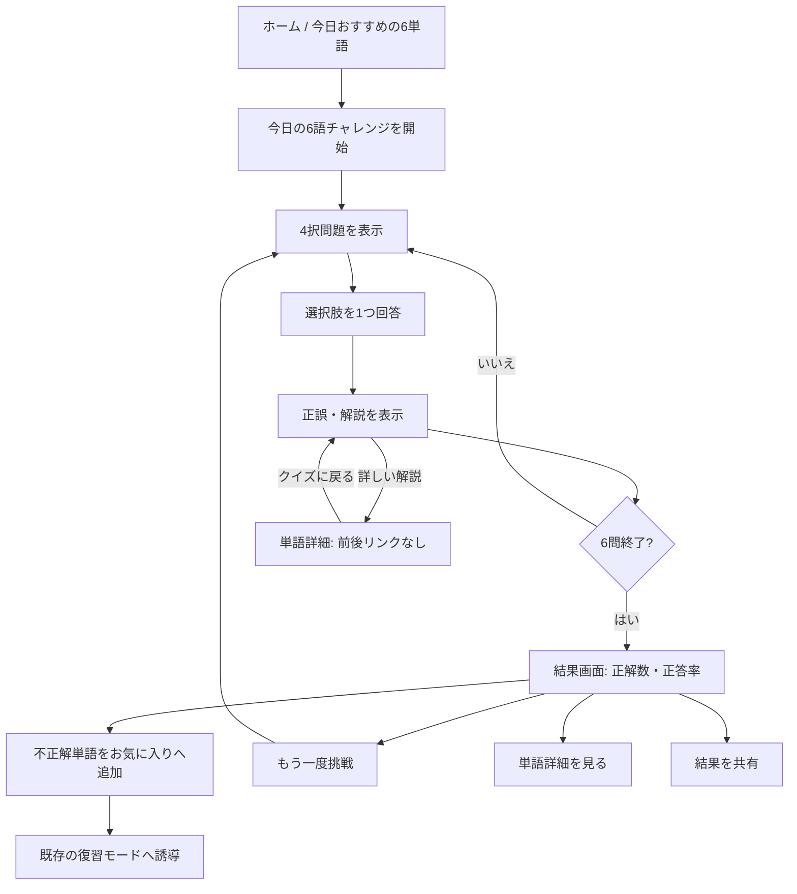
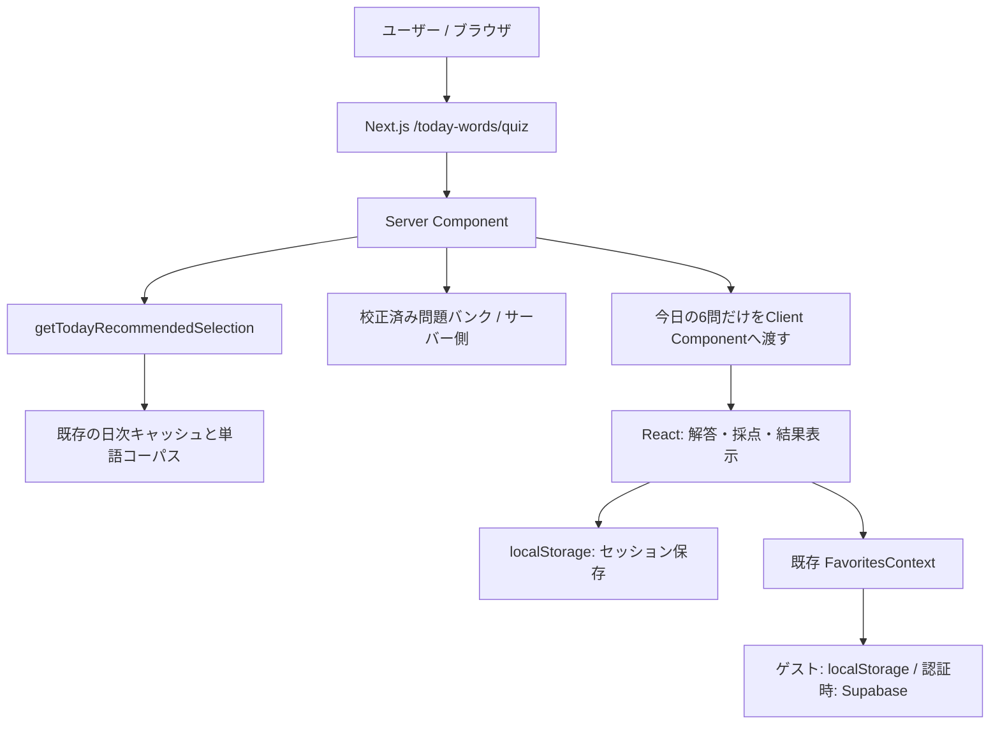

# TOEIC語彙ラボ「今日の6語チャレンジ」実装イメージ・実現性評価

- **作成日**：2026-11-10
- **最終更新日**：2026-11-11（既存コードとの照合レビューを反映。変更点は「1.1 レビュー反映の要点」を参照）
- **対象サイト**：[TOEIC語彙ラボ](https://www.toeic-words.com/)
- **参照リポジトリ**：[Rainnnnnnnn-maker/toeic_website_ver2.0](https://github.com/Rainnnnnnnn-maker/toeic_website_ver2.0)（`main` ブランチの確認結果に基づく）
- **文書ステータス**：検討の経緯（下の「実装状況」を参照。現行の仕様は [docs/specs/daily-quiz/spec.md](../specs/daily-quiz/spec.md)）
- **推奨案**：A案 ― 既存の「今日の6単語」と同じ単語を出題する、登録不要の4択クイズ。問題バンクは全語を一括で整備せず、出題予定の先読み期間から段階的に校正する

---

## 実装状況（2026-11-11）

ブランチ `claude/today-quiz-prototype` で、クイズを実装した。**問題の用意の仕方は本書の推奨（静的な問題バンクを先読み期間分だけ校正する）から変更した。** 現行の仕様は [docs/specs/daily-quiz/spec.md](../specs/daily-quiz/spec.md) を正とし、本書は検討の経緯として残す。

| 項目 | 本書の案 | 実装 |
|---|---|---|
| 問題の用意 | 静的な問題バンク（6.4のD案＋E案）。実行時にAIを呼ばない | 毎日1回、日次CronでGeminiに誤答を生成させ、Upstash Redisに8日間保存する（6.4のB案に検証・確認・代替を加えたもの） |
| 正解と解説 | 問題バンクに持つ | 既存の訳と例文をそのまま使う（E案の方法） |
| 誤答 | 既存の訳、または自由生成したものを人が校正 | Geminiが生成し、機械的な検証と別依頼の確認を通す。使えない語はE案の方法で代替する |
| 人による校正 | 公開条件 | 行わない。そのためページは `noindex` |
| 解ける範囲 | 当日のみ | 今日を含む直近7日分 |
| 入口 | 6語のカードの下に案内の箱 | 「聞き流し」の隣に「クイズ」ボタン |
| 先読みの網羅監査（6.3） | 必要 | 不要になった（毎日その日の分だけ作るため） |
| 連続チャレンジ日数・結果共有（8.3） | MVPに含める | 未実装 |

本書のうち、`from=quiz`（7.4）、端末保存の固定キーと作り直し時の扱い（8.1）、既存の一括お気に入りと計測の再利用（9章、11章）は実装に反映した。

---

## 1. 結論・実現性

**結論：技術面では実現可能。既存アプリへの影響を小さく抑えられる。**

既存の Next.js 16 / React 19 構成と日替わり単語選出処理をそのまま利用すれば、クイズUI・正誤判定・結果表示・ゲスト利用・ローカル保存は新たなバックエンド、データベース、常時AI呼び出しなしで実装できる。

ただし、**最大の実装・運用リスクは「正解が一意に定まる4択問題を、出題される単語すべてに用意し続けること」**である。既存の「今日の6単語」は全収録語（ローカルの `__words__` で1,392語）から選ばれるため、無作為に一部の単語だけ問題化すると6問保証が崩れる。一方、日替わり選出は日付キーとslugだけで決まる決定論的な処理であり、先の日付の6語は事前に計算できる。そこで公開条件は「全語100%」ではなく、**「今後の先読み期間（初期値60日）に出題される全単語が校正済みであること」**とする（根拠は6.4）。

| 項目 | 実現性 | 理由・条件 |
|---|---|---|
| 6問4択の画面・採点 | **高** | React Client Componentとローカル状態だけで成立 |
| 既存「今日の6語」と一致する出題 | **高** | `getTodayRecommendedSelection()`を共用 |
| ログイン不要・途中再開 | **高** | `localStorage` に日付・バージョン付きで保存 |
| 不正解単語をお気に入りに追加 | **高** | 既存`useFavorites().addFavorites()`を流用 |
| 既存の復習管理への影響抑止 | **高** | `recordGrade()`を呼ばず、復習実績は改変しない |
| 日付切替・キャッシュ整合 | **中〜高** | 現行のJST 7:00基準と7:05 Cronの境界を扱う |
| 先読み期間分の校正済み問題データ | **中〜高** | 60日分は323語（全体の23%）。AIによる候補生成は可能だが、意味の重複・多義語・曖昧な誤答の人手監査が必要 |
| 全単語分の校正済み問題データ | **中** | 公開後に計測結果を見て段階的に拡張する。公開条件にはしない |
| 単語詳細への遷移（`from=quiz`） | **高** | 既存の `from=review` と同じ扱いを `WordNavigationClient` に追加する |
| 端末内の連続チャレンジ日数・結果共有 | **高** | `localStorage` と既存 `SnsShareButtons` で成立。Supabaseは使わない |
| 学習成果・PV改善の保証 | **未検証** | GA4で導入前後の行動指標を測定して判断する |

### MVPで実現すること

- 既存「今日おすすめの6単語」と同じ6語を、同じ順序で出題する。
- 日本語の意味を選ぶ4択を、1問ずつ計6問表示する。
- 回答直後に正誤・短い解説・単語詳細リンクを表示する。
- 途中再開、完了結果の表示、同じ日の再挑戦を提供する。
- 不正解単語を既存のお気に入りへ、ユーザー操作で一括追加できる。
- 解説リンクで開いた単語詳細には前後の単語リンクを出さず、「クイズに戻る」だけを表示する。
- 完了した日を端末内に記録し、連続チャレンジ日数の表示と結果（正解数のみ）の共有を提供する。
- 当日の6語に校正済み問題が揃っていない日は、開始ボタンを表示しない。
- 認証不要で利用でき、既存の学習・復習モードやSEOページを壊さない。

### 初期版の対象外

リアルタイム対戦、ランキング、制限時間、AIによる毎回の問題生成、音声認識、新規Supabaseテーブル、クイズ結果を使った自動Leitner昇格、複雑な実績システムは対象外とする。連続チャレンジ日数は端末内の記録だけで扱い、アカウント同期やバッジなどの実績機能には広げない。

### 1.1 レビュー反映の要点

2026-11-10に本書を既存コードと照合した。2章で参照している関数・型・Cron・npmスクリプトは実在し、記述と一致していた。そのうえで次の点を見直した。

| # | 見直した点 | 理由 | 反映先 |
|---|---|---|---|
| 1 | 公開条件を「全語100%」から「先読み期間の網羅」へ変更 | 全件を校正しても、その大半は公開後しばらく出題されない。効果が未検証の段階で最大のコストを先払いしない | 6.3、6.4、13章、14章 |
| 2 | 網羅の監査対象を本番のBlobコーパスにする | 単語リストはVercel Blobにあり、デプロイなしで変わる。リポジトリ内の問題バンクとはCIだけでは突き合わせられない | 6.3 |
| 3 | 単語詳細リンクに `from=quiz` を追加 | `from=today` で開くと今日の6語の前後リンクが出て、未回答の問題の答えを先に見られる | 2章、7.4、9章 |
| 4 | 連続チャレンジ日数と結果共有をMVPへ追加 | KPIに再訪率を挙げているが、再訪を促す仕組みがなかった | 3章、8.3、11章 |
| 5 | 選択肢の並びを初期版から決定論的にシャッフル | 生成データの正解位置が偏ると、位置で正解を当てられる | 6.2 |
| 6 | 保存キーを固定の1つに変更し、照合を問題ID単位にする | 日付入りのキーは毎日1件ずつ残り続ける。補充のたびに進行中の状態を捨てない | 8.1、8.2 |
| 7 | お気に入り一括追加と計測は既存実装を再利用 | `StudyBulkFavoriteButton` と `favorite_bulk_add` が既にある | 9章、11章 |
| 8 | PRの順序を入れ替え | 問題バンクの完成を最初のPRの完了条件にすると、UIの検証まで止まる | 14章 |
| 9 | E案（選択肢を既存の訳から組む）を試作し、結果を記録（2026-11-11） | 校正量を左右する最大の未確定要素だった。全1,392語で問題を組め、機械的な確認点は8.6%に収まった | 6.4、6.5 |

---

## 2. 既存実装との対応関係

| 既存実装 | 現状 | クイズでの扱い |
|---|---|---|
| `src/data/words.ts` | `Word`型、`getTodayRecommendedSelection()`、`dateKey`・`wordListVersion` | **変更せず使用** |
| `src/lib/word-select.ts` | `TODAY_WORDS_COUNT = 6`、`getTodayKey()`、決定論的選出 | **変更せず使用** |
| `src/app/page.tsx`、`src/app/today-words/page.tsx` | 今日の6単語を取得して表示 | 当日の問題が揃っているかをサーバー側で判定し、真偽値（`quizAvailable`）を渡す |
| `src/components/features/words/TodayRecommendedWordsClient.tsx` | ホームのプレビュー／今日の一覧表示 | 開始ボタンを追加（`quizAvailable` が真の日のみ表示） |
| `src/lib/today-navigation.ts` | 今日の単語詳細ページの遷移スナップショット（`from=today&picks=...`） | **クイズからの詳細リンクには使わない**。前後リンクで未回答の単語を見られるため |
| `src/components/features/words/WordNavigationClient.tsx` | `from` の値で戻り先と前後リンクを切り替える。`from=review` は前後リンクを出さない | `from=quiz` を追加し、「クイズに戻る」だけを表示（7.4） |
| `src/context/FavoritesContext.tsx` | `addFavorites(slugs)`／ローカル・Supabase同期 | 不正解語の登録で流用（`StudyBulkFavoriteButton` 経由） |
| `src/components/features/study/StudyBulkFavoriteButton.tsx` | 未登録語の一括お気に入り追加。読み込み中の待機と `favorite_bulk_add` の送信を実装済み | `source` に `quiz_result` を追加して再利用 |
| `src/components/features/sns/SnsShareButtons.tsx` | X・Facebook・LINEの共有ボタン。`share` イベントを送信 | 結果画面で再利用 |
| `src/lib/word-source.ts` | ローカル／Blobの単語リスト読込。`scripts/embed-words.ts` も使用 | 網羅監査CLIから同じローダーで本番コーパスを読む |
| `src/lib/review-schedule.ts` | Leitner方式：1・3・7・14・30日 | **変更せず独立維持** |
| `src/hooks/useReviewProgress.ts` | ログイン中の復習採点・ストリーク更新 | MVPからは呼ばない |
| `src/data/word-detail.ts` | Gemini＋Redis＋Next.js Cacheによる詳細取得 | **クイズ実行時には原則呼ばない**。問題作成時の参考とする |
| `vercel.json` | UTC `22:05` に日次再検証（JST 7:05） | **Cronは追加しない** |
| `package.json` | Next.js、React、Vitest、Cypressなど | 既存ライブラリを使用 |

> **現行の重要仕様**：日付キーはJST **7:00** で切り替わる設計。公開画面の「今日の6単語」データは日次キャッシュを利用し、JST **7:05** のCronで再検証する。この約5分の差をクイズ側で独自実装せず、`getTodayRecommendedSelection()`の取得結果を唯一の基準にする。

### 既存のWord型

```ts
export type Word = {
  slug: string;
  term: string;
  level: 'important' | 'medium' | 'high';
};
```

クイズ固有情報はこの型に追加しない。既存の一覧・検索・詳細・学習への影響を避けるため、別の問題データ型を新設する。

---

## 3. ユーザー体験・画面イメージ

### 3.1 画面遷移



### 3.2 ホームまたは「今日の6単語」画面

```text
┌───────────────────────────────────────────────┐
│ 今日おすすめの6単語                   [聞き流し] │
│                                               │
│ [word 1] [word 2] [word 3]                   │
│ [word 4] [word 5] [word 6]                   │
│                                               │
│ ┌───────────────────────────────────────────┐ │
│ │ 今日の6語を覚えたかチェック！               │ │
│ │ 約2〜3分 / 4択 / 登録不要                  │ │
│ │        [6語チャレンジを始める]              │ │
│ └───────────────────────────────────────────┘ │
└───────────────────────────────────────────────┘
```

当日の6語に校正済み問題が揃っていない場合、このボタンは表示しない。判定はServer Componentで行い、真偽値だけをClient Componentへ渡す。

### 3.3 クイズ画面

```text
┌───────────────────────────────────────────────┐
│ 今日の6語チャレンジ                 2 / 6問    │
│ [██████░░░░░░░░░░░░░░░]                        │
│                                               │
│ Q. "implement" の意味は？                    │
│                                               │
│  (A) 実施する                                 │
│  (B) 延期する                                 │
│  (C) 取り消す                                 │
│  (D) 報告する                                 │
│                                               │
│ 回答後：                                      │
│ ✓ 正解！                                      │
│ implement a policy = 方針を実施する            │
│ [単語の詳しい解説]          [次の問題へ]        │
└───────────────────────────────────────────────┘
```

「単語の詳しい解説」は `/words/<slug>?from=quiz` を開く。詳細ページには前後の単語リンクを出さず、「クイズに戻る」で同じ問題の解説表示へ戻る（7.4）。

### 3.4 結果画面

```text
┌───────────────────────────────────────────────┐
│                 チャレンジ完了！               │
│                     4 / 6                    │
│                   正答率 67%                  │
│               連続チャレンジ 3日目             │
│                                               │
│ 不正解の単語：                                 │
│ [implement]  [negotiate]                      │
│                                               │
│ [不正解の2語をお気に入りに追加]                │
│ [結果を共有]                                   │
│ [もう一度チャレンジ]                           │
│ [今日の6単語に戻る]                            │
└───────────────────────────────────────────────┘
```

UIは既存のブルー系配色、Tailwind CSS、Lucideアイコンを流用する。スマートフォンでは選択肢・操作ボタンを縦並びとし、タップ領域を確保する。

---

## 4. 推奨アーキテクチャ



**意図的に増やさないもの**：API Route、常時実行の生成AI、Redisの新規用途、クイズ専用データベース。6問の問題データはServer Componentで選定した後、必要な6問のみClient Componentへ渡す。

### Server / Clientの責務

- **Server**：今日の単語選出、問題バンク照合、6問の整列、メタデータとエラー・利用不可時の表示。
- **Client**：解答操作、二重回答防止、進行管理、結果表示、ブラウザ保存、既存Favoritesへの追加。
- **問題バンク**：配信中は確定した静的データ。作問・校正はビルド前または管理用CLI側で行う。

> 学習用クイズであるため、初期版では正解IDをClientへ渡して採点してよい。ただし、不正防止が必要な競争型ランキングを将来導入する際にはサーバー側採点への変更が必要。

---

## 5. ファイル構成と変更範囲

```text
src/
├── app/
│   ├── page.tsx                           # 既存：quizAvailable を渡す
│   └── today-words/
│       ├── page.tsx                       # 既存：quizAvailable を渡す
│       └── quiz/
│           └── page.tsx                   # 新規：クイズページ（Server）
├── components/features/
│   ├── words/
│   │   ├── TodayRecommendedWordsClient.tsx # 既存：開始リンク追加（問題が揃う日のみ）
│   │   └── WordNavigationClient.tsx       # 既存：from=quiz を追加
│   ├── study/
│   │   └── StudyBulkFavoriteButton.tsx    # 既存：source に quiz_result を追加
│   └── quiz/
│       ├── TodayQuizClient.tsx            # 新規：状態管理（Client）
│       ├── QuizQuestion.tsx               # 新規：設問と4択
│       ├── QuizFeedback.tsx               # 新規：正誤・解説
│       ├── QuizProgress.tsx               # 新規：進捗表示
│       └── QuizResult.tsx                 # 新規：結果・復習導線
├── data/
│   ├── quiz-questions.json                # 新規：校正済み問題バンク
│   └── quiz-questions.ts                  # 新規：サーバー側読込・照合
├── lib/
│   ├── quiz-types.ts                      # 新規：型
│   ├── quiz-utils.ts                      # 新規：採点・集計・並べ替え・連続日数（純関数）
│   ├── quiz-session-store.ts              # 新規：保存・復元（進行状態と完了日）
│   └── (tests)/
│       ├── quiz-utils.test.ts            # 新規
│       └── quiz-session-store.test.ts    # 新規
scripts/
└── audit-quiz-questions.ts                # 新規：Blobコーパスに対する先読み網羅の監査
```

※ 現行のコードレイアウトを維持し、`src/lib/review-schedule.ts` と `src/hooks/useReviewProgress.ts` には手を入れないことを基本とする。

---

## 6. 問題データ仕様

### 6.1 TypeScript型

```ts
export type QuizType = 'meaning-ja';

export type QuizOption = {
  id: string;
  text: string;
};

export type QuizQuestion = {
  id: string;
  slug: string;
  type: QuizType;
  prompt: string;
  options: QuizOption[]; // 実行時バリデーションで必ず4件
  correctOptionId: string;
  explanation: string;
};

export type TodayQuizPayload = {
  dateKey: string;
  wordListVersion: string;
  questionBankVersion: string;
  questions: QuizQuestion[];
};

export type QuizAnswer = {
  questionId: string;
  slug: string;
  selectedOptionId: string;
  isCorrect: boolean;
};
```

### 6.2 JSON例（構造例であり本番収録語の確定データではない）

```json
{
  "version": 1,
  "items": {
    "implement": {
      "id": "meaning-implement-001",
      "slug": "implement",
      "type": "meaning-ja",
      "prompt": "implement の意味として最も適切なものは？",
      "options": [
        { "id": "a", "text": "実施する" },
        { "id": "b", "text": "延期する" },
        { "id": "c", "text": "取り消す" },
        { "id": "d", "text": "報告する" }
      ],
      "correctOptionId": "a",
      "explanation": "implement a policy は『方針を実施する』という意味です。"
    }
  }
}
```

**実装ルール**：`slug` をキーとして問題を管理し、その日の`selection.words`に対応する問題を同じ順序で取り出す。

**選択肢の並び**：初期版から決定論的にシャッフルする。Server Componentで `hashString("<dateKey>:<questionId>:<optionId>")` の昇順に並べ替えてからClient Componentへ渡す（`hashString` は `word-select.ts` の既存関数）。生成データは上のJSON例のように正解が先頭に偏りやすく、静的な並びのままだと位置で正解を当てられるためである。回答は選択肢IDで保存するので、並びが変わっても保存値との整合は崩れない。画面上の (A)〜(D) は並べ替え後の表示位置に付け、選択肢IDとは別に扱う。

**版の扱い**：JSONの `version`（`QUESTION_BANK_VERSION`）はデータ形式の版とし、問題の補充では変えない。個々の問題の内容を直したときは、その問題の `id` の連番を上げる。進行中のセッションとの照合は問題ID単位で行う（8.1）。

### 6.3 問題バンクの品質チェック

**CIで自動確認する項目**（Vitest。ネットワークと秘密情報を使わない構造検証）

1. 問題バンク内でslugが重複しない。
2. `id` が一意で、`slug` と問題IDの対応が矛盾しない。
3. `type = meaning-ja`、選択肢4件、各`id`が一意、正解IDが選択肢内に1件存在する。
4. 空の文章・極端に長い文章・完全一致する選択肢がない。
5. 問題のバージョン／検証済みフィンガープリントが定義されている。

**コーパスに対する網羅監査**（CLI：`scripts/audit-quiz-questions.ts`）

本番の単語リストはVercel Blobにあり、Blobの更新と `/api/revalidate/words` の実行で、デプロイなしに切り替わる。問題バンクはリポジトリ内の静的データなので、ローカルの `__words__` と照合するだけでは本番での網羅を保証できない。そこで監査は次のとおり行う。

- `src/lib/word-source.ts` の `loadWordData(resolveDefaultWordSource())` で、サイトが配信しているものと同じBlobコーパスを読む（`scripts/embed-words.ts` と同じ方式）。
- 今日から先読み期間（初期値60日）の各日について `selectTodayWords` で6語を計算し、問題バンクと照合する。
- 問題が欠けている日と単語、問題が連続して揃っている残り日数、コーパスに存在しないslugの問題を出力する。
- 残り日数が下限（初期値14日）を下回ったら非ゼロで終了する。
- 既存のCIはアプリの秘密情報を持たず、ローカルのHTTPフィクスチャで動く。このCLIはCIの必須ジョブにせず、公開前・単語リストの更新時・定期の補充時に実行する。
- 単語リストを更新する運用手順に「監査CLIを実行し、欠けた問題を補充する」を加える。

**人手・言語品質レビューで確認する項目**

- 多義語で正解が一意に決まるか（必要に応じて文脈のある設問にする）。
- 類義語・言い換えが複数正解として成立しないか。
- TOEICのビジネス文脈・学習レベルに適切か。
- 日本語訳・解説に誤りがないか。

既存の`src/lib/content-review.ts`には内容のフィンガープリントと人手レビュー判定の仕組みがあるため、設計思想を参照できる。ただし、**現行コードがクイズ問題バンクにそのまま適用済みという意味ではない**。採用する場合は新しい問題監査フローに組み込む。

### 6.4 代替案比較：問題バンクの作り方

ここでのA〜Eは問題バンクの作り方の比較であり、冒頭の「A案」（機能全体の案）とは別である。

| 案 | 概要 | 実現性 | 初期運用コスト | 評価 |
|---|---|---|---|---|
| A. 全語の問題を事前生成・校正 | 収録語全件の4択を事前用意し静的配信 | 高（品質監査に工数） | 初期は大、実行時は小 | 公開条件にはしない。公開後の拡張目標 |
| **D. 先読み期間分を校正し、継続的に補充** | 決定論的な選出を事前計算し、今後N日に出題される語から校正して静的配信 | 高 | 初期は小〜中、定期の補充が必要 | **推奨** |
| B. 日々必要な6問をGeminiで実行時生成 | 毎日の問題をサーバーで生成 | 中 | API費・遅延・品質変動 | MVPでは非推奨 |
| C. 未作成語を出題から除外 | 問題がある単語だけで6問選出 | 高 | 小〜中 | 既存「今日の6語」と不一致になるため非推奨 |
| **E. 選択肢を既存の訳から組む** | 正解は当該語の `japaneseTranslation`、誤答は語形の同じ他の収録語の訳から選ぶ | 高（試作済み） | 生成が不要で、校正は組み合わせの確認になる | **D案と併用を推奨**（6.5） |

**出題頻度の試算**：2026-11-10を起点に、ローカルの `__words__`（1,392語）へ `selectTodayWords` を適用した結果である。

| 期間 | 出題される語（重複除く） | コーパス比 |
|---|---:|---:|
| 14日 | 81語 | 5.8% |
| 30日 | 168語 | 12.1% |
| 60日 | 323語 | 23.2% |
| 90日 | 454語 | 32.6% |
| 365日 | 1,099語 | 79.0% |
| 730日 | 1,327語 | 95.3% |

- 全件を校正しても、約2割の問題は1年間出題されない。A案を公開条件にすると、効果が未検証の段階でこの分まで先に校正することになる。
- 選出は `hashString("<dateKey>:<slug>")` の昇順で決まり、各語の順位は他の語に依存しない。コーパスから10語を削除した試算では、90日のうち選出が変わったのは2日だった。語の追加・削除で先読み分の大半が無効になることはない。
- 本番のBlobコーパスはローカルの写しと差がある可能性があり、上の数値は目安である。実際の対象語は監査CLI（6.3）の出力を正とする。

**Go/No-Go条件**：初回本番公開前に、今後60日に出題される全単語について「問題あり・4択形式妥当・内容レビュー済み」を100%にする。公開後は、問題が揃っている残り日数が14日を下回らないよう補充する。60日・14日は初期値であり、補充の負荷を見て調整する。正解の一意性は機械的な構造検証だけで保証できないため、別途内容レビューを通す。問題不足時に別の6語へ静かに差し替える実装はしない。問題が揃っていない日は開始ボタンを出さず、直接アクセスには準備中の案内を表示する。

**E案**：`WordDetails.japaneseTranslation` は単語詳細に表示している訳である。正解をこの訳、誤答を語形の同じ他の収録語の訳にすれば、新しい文章を生成せずに問題を組める。解説も既存の例文（`pickExample`）で足りる。D案が「どの語をいつまでに用意するか」を決めるのに対し、E案は「選択肢をどう作るか」の案であり、両者は併用できる。2026-11-11に試作して確かめた（6.5）。採用する場合も、実行時にRedisやGeminiを読まず、確定した静的データとして配信する方針は変えない。

### 6.5 E案の試作結果（2026-11-11）

**実装**（ブランチ `claude/today-quiz-prototype`）

- `src/lib/quiz-question-builder.ts`：問題を組み立てる純粋ロジック。単体テストは `src/lib/(tests)/quiz-question-builder.test.ts`（48件）。
- `scripts/prototype-quiz-questions.ts`：`npm run quiz:prototype` で実行するCLI。Blobの単語リストとRedisの解説を読むだけで、生成も書き込みもしない。`-- --days=N`、`-- --start=YYYY-MM-DD`、`-- --source=local|blob`、`-- --snapshot`（前回取得した解説を使い、通信しない）を指定できる。
- 出力は git 管理外の `.artifacts/quiz-prototype/`。`report.md` に集計と先読み期間の問題の一覧、`questions.json` に問題データが入る。
- `preview/index.html` は、問題をブラウザで実際に解いて確かめる単独のHTMLである（組み立ては `scripts/quiz-prototype-preview.ts`）。日付を選んでその日の6問を解く画面と、全問を一覧して確認点のある問題だけに絞れる画面がある。問題の質を見るための画面で、本番のクイズUIではない。Claude Code のブラウザでは `.claude/launch.json` の「Quiz Prototype Preview」（`http://localhost:4173`）で開ける。

**組み立て方**（文面は書き換えず、既存の訳語から選ぶだけ）

1. 訳語の語形（動詞形・形容詞形・副詞形・名詞形）を決める。品詞表記が1つならそれに従い、複数ある語だけ語尾で選ぶ。
2. 選択肢の文面は、先頭の訳語と同じ語形の訳語を先頭から2つまで。「プレビュー」のようなカタカナだけの訳語は、他に訳語があれば外す。
3. 誤答は語形が同じ語から選ぶ。類義語として登録済みの語、同じ類義語を共有する語、派生語、訳語の語幹が重なる語は除外する。
4. 訳語の数とレベルが近い語を優先し、同順位はハッシュ順にする。選択肢の並びもハッシュ順で、同じ入力からは同じ問題になる。

**計測結果**（本番のBlobコーパス1,392語）

| 確認した点 | 結果 |
|---|---|
| 訳を取得できた語 | 1,392語すべて（Redis 1,377、編集済みデータ 15、未キャッシュ 0） |
| 訳の原文の形式 | 特に問題のない語は990語（71.1%）。訳語が4つ以上 225語、カタカナだけの訳語を含む 113語、語形の混在 87語、20文字超 68語、括弧書き 53語、「〜」を含む 26語 |
| 選択肢の文面に絞った後 | 問題のない語は1,325語（95.2%）。文字数の中央値は7、90パーセンタイルは11 |
| 問題を組めた語 | 1,392語（100%）。誤答が足りない語は0 |
| 機械的な確認点が付いた問題 | 120問（8.6%）。正解だけが長い 76、浮く語形 20、括弧書き 18、「〜」17、カタカナ語だけ 9、20文字超 6、正解だけが短い 4（重複あり） |
| 正解の位置 | a 26.0%、b 27.1%、c 22.7%、d 24.2% |
| 先読み14日分（81語） | 81問すべて組め、14日とも6問が揃う。確認点が付いたのは7問 |

**目視の結果**：先読み14日分の81問と、全体から10語おきに抜き出した139問を確認した（重複を除いて約210問）。**確認したのはAIであり、人による確認ではない。**

- 正解が複数成立する問題は見つからなかった。
- 最初の版（訳の原文をそのまま使い、語尾だけで語形を決める）では、81問のうち約2割で、語形の違いから正解や誤答を絞れた。「隣接した」「価値のある」のような形容詞の訳を、動詞や名詞と取り違えたためである。品詞表記を優先する形に直して解消した。
- 「占められている」「喜んで」「最新式」のように、同じ語形の中で浮く訳は `irregular-form` として検出し、誤答の候補から外した。

**残る限界**

- 訳語を2つに絞るため、TOEICで重要な語義が落ちることがある。例：board は「板、掲示板」となり「取締役会」が出ない。訳語の並びは重要度順ではない。
- 類義の検出は、訳語の文字列と登録済みの類義語に頼っている。訳語も類義語も重ならない近い意味の語は検出できない。採用するなら、既存のUpstash Vectorの埋め込みで近傍の語を除外する方法を追加できる（未実装）。
- 誤答は意味の関連が薄い語になりやすく、難易度は低めになる。例：meal（食事）に対して「家具」「生産性」「請求書」。
- 解説がRedisで再生成されると訳が変わり、問題も変わる。配信するデータは生成時点で固定し、内容の版を記録する必要がある。
- 元データの不整合がそのまま問題に出る。試作中に見つかった例：`finate`（`word_mid.txt` の綴り。finite の誤りと思われる）、novel（品詞は名詞のみだが訳に「新しい」）、state-of-the-art（形容詞だが訳が「最先端、最新式」）。

**評価**：E案は成立する。全語で問題を組め、機械的な確認点は1割未満に収まった。校正の対象は「自由に生成した4択と解説」から「既存の訳の組み合わせに問題がないかの確認」に変わる。1問20〜30秒で確認できると仮定すると、先読み60日分（323語）は約2〜3時間の試算になる（D案で自由生成する場合は約5〜11時間）。ただし人による確認が不要になるわけではなく、確認点の付いた問題は差し替えか手直しが要る。

---

## 7. ページ・コンポーネント設計

### 7.1 Server Component

`src/app/today-words/quiz/page.tsx` の想定：

```tsx
import type { Metadata } from 'next';
import { getTodayRecommendedSelection } from '@/data/words';
import { getQuizQuestions, QUESTION_BANK_VERSION } from '@/data/quiz-questions';
import TodayQuizClient from '@/components/features/quiz/TodayQuizClient';

export const metadata: Metadata = {
  title: '今日の6語チャレンジ',
  description: 'TOEIC重要単語を毎日6問の4択クイズで確認できます。',
  alternates: {
    canonical: 'https://www.toeic-words.com/today-words/quiz',
  },
};

export default async function TodayQuizPage() {
  const selection = await getTodayRecommendedSelection();
  // 新設・サーバー専用。選択肢は6.2の規則で並べ替えて返す
  const questions = getQuizQuestions(selection.words, selection.dateKey);

  // 現場実装では不足時に公開ユーザー向けの案内UIを出す。
  if (questions === null || questions.length !== selection.words.length) {
    return <main>現在クイズを準備中です。今日の6単語をご利用ください。</main>;
  }

  return (
    <main className="mx-auto w-full max-w-2xl px-4 py-8">
      <TodayQuizClient
        key={`${selection.dateKey}:${selection.wordListVersion}:${QUESTION_BANK_VERSION}`}
        dateKey={selection.dateKey}
        wordListVersion={selection.wordListVersion}
        questionBankVersion={QUESTION_BANK_VERSION}
        questions={questions}
      />
    </main>
  );
}
```

上記は**設計用コード例**であり、コンポーネントのimport先や実装は新規作成が必要。`getQuizQuestions`はサーバー専用ファイルで実装し、問題バンク全量をクライアントに渡さない。問題不足を見つけたら監視ログも出す。

### 7.2 Reactの責務

| コンポーネント | 入力 | 責務 |
|---|---|---|
| `TodayQuizClient` | 6問、日付、2種のバージョン | 状態遷移、採点確定、保存・復元、集計 |
| `QuizProgress` | 現在問数、総数、正解数 | 進捗表示 |
| `QuizQuestion` | 問題、選択済みID、回答可否 | 設問と4択、クリック通知 |
| `QuizFeedback` | 問題、回答結果 | 正誤・解説・単語詳細リンク（`/words/<slug>?from=quiz`） |
| `QuizResult` | 全回答、6問、連続チャレンジ日数 | 結果、弱点表示、連続チャレンジ日数、共有、お気に入り追加、再挑戦・復習導線 |

### 7.3 クライアント状態遷移

```text
ready --開始--> playing --回答--> feedback
                              feedback --残問あり--> playing
                              feedback --全問終了--> completed
                              completed --再挑戦--> playing
```

最小状態例：

```ts
const [phase, setPhase] = useState<'ready' | 'playing' | 'feedback' | 'completed'>('ready');
const [currentIndex, setCurrentIndex] = useState(0);
const [answers, setAnswers] = useState<QuizAnswer[]>([]);
const [selectedOptionId, setSelectedOptionId] = useState<string | null>(null);
```

`score`や`wrongSlugs`は原則`answers`から派生計算し、独立した状態を増やさない。回答確定後は選択肢を無効化し、同一問題の二重採点を防止する。リロード復元処理では保存値の検証を行う。

### 7.4 単語詳細ページ側の変更（`from=quiz`）

`WordNavigationClient` は `from` の値で戻り先と前後リンクを決めている。`from=review` では「復習に戻る」だけを表示し、前後リンクを出さない。同じセッションの未採点カードを先に見られるのを防ぐためである。クイズでも、`from=today` で詳細を開くと今日の6語の前後リンクが表示され、未回答の問題の単語と意味を先に見られる。そこで `from=quiz` を次の仕様で追加する。

- 戻りリンクは「クイズに戻る」（`/today-words/quiz`）とする。
- 前後の単語リンクは表示しない。
- `picks` などの選出情報はURLに載せない。単語詳細ページから日次選出（`getTodayRecommendedSelection()`）を読まない既存方針を維持する。
- クイズへ戻ったときは、保存済みセッションから同じ問題の解説表示（`feedback`）を復元する。
- Cypressの `word-detail-navigation.cy.ts` に、クイズ起点の詳細で前後リンクが出ないことの確認を追加する。

結果画面からの詳細リンクも同じ `from=quiz` に揃える。完了後は未回答の問題がないが、戻り先を1つにして挙動を単純に保つ。

---

## 8. ローカル保存の設計

### 8.1 保存キー・保存データ

```text
toeic-today-quiz:v1
```

キーは固定の1つにする。日付や版をキー名に含めると、毎日新しいキーが1件ずつ増えて残り続けるためである。日付・単語版・形式の版は保存データの中に持ち、復元時にサーバーから渡された値と照合する。

```ts
type PersistedQuizSessionV1 = {
  version: 1;
  dateKey: string;
  wordListVersion: string;
  questionBankVersion: string;
  phase: 'ready' | 'playing' | 'feedback' | 'completed';
  currentIndex: number;
  answers: QuizAnswer[];
  selectedOptionId: string | null;
  updatedAt: number;
};
```

- 回答確定時・画面状態変更時に保存する。保存失敗時は機能を継続できるようにする。
- 復元時は問題数・`questionId`・`slug`・選択肢ID・進行状態を必ず検証する。`dateKey`・`wordListVersion`・`questionBankVersion` のいずれか、または当日6問の `questionId` の並びが保存値と違えば、保存データを破棄して初期状態から始める。
- `questionBankVersion` はデータ形式の版であり、問題の補充では変わらない（6.2）。補充のたびに変えると、当日の6問が同じでも進行中の状態を失うためである。問題の内容を直した場合は `questionId` が変わるので、上の照合で旧状態を流用しない。
- `localStorage`はブラウザ実行時にのみ参照する。SSR初期描画時は未復元状態を描き、Hydration不一致を回避する。
- 当日再挑戦は解答配列をリセットする。完了結果を履歴として残すかは次段階で決める。
- ローカル保存は端末単位であり、ゲストのクイズ結果は別端末へ同期しない。ログインアカウント別の結果同期もMVP対象外。
- `dateKey`はブラウザ時計から再計算せず、サーバーから渡された選定結果のものを使用する。

### 8.2 日次切替

| 時点 | 仕様 |
|---|---|
| JST 6:59 | 旧日付のセット |
| JST 7:00〜7:05頃 | 既存のキャッシュ状態に合わせたセット。独自に切り替えない |
| Cron再検証後の次回取得 | 新しい日付のセット |
| クイズ途中で日付境界を越えた | 画面上の6問はそのまま完了できる。再読込時に新日付へ切替可 |
| 問題バンクに問題が補充された | 当日6問の `questionId` が同じなら、進行中の状態を引き継ぐ |
| 当日の問題の内容が修正された | `questionId` が変わるため、旧状態を流用しない |
| 問題バンクの形式が変わった | `questionBankVersion`違いとして旧状態を流用しない |

Cronやキャッシュの処理が遅延した場合に「7:05に必ず新しいセットが見える」と保証しないこと。**どの6語を出題するかは、ページ取得時に返された選定結果が正**である。

### 8.3 連続チャレンジ日数と結果共有

再訪を促す仕組みとして、端末内の記録だけで成立する2つをMVPに含める。

- **完了日の記録**：6問を終えた日の `dateKey` を別の固定キー（`toeic-today-quiz-history:v1`）に保存する。保持は直近60件（初期値）までとし、古いものから捨てる。
- **連続チャレンジ日数**：保存した `dateKey` の並びから純関数で計算する（`quiz-utils.ts`、単体テスト対象）。当日を完了していれば当日を含めて数え、未完了なら前日までの連続を表示する。基準日はサーバーから渡された `dateKey` を使い、ブラウザの時計や描画経路での `new Date()` を使わない。
- **既存のストリークとの区別**：マイページの連続学習日数（`learning_streaks`、ログイン必須、復習の採点で更新）とは別の記録である。画面上は「連続チャレンジ」と表記し、同じ数字だと誤解させない。クイズの完了で `learning_streaks` は更新しない。
- **結果共有**：結果画面に既存の `SnsShareButtons` を置く。共有文は正解数だけ（例：「今日の6語チャレンジ 4/6」）とし、出題語や正解は含めない。URLは `/today-words/quiz` を使う。
- 端末を変えると記録は引き継がれない。アカウント同期は計測結果を見てから検討する。

---

## 9. お気に入り・復習機能との接続

既存の`FavoritesContext.tsx`には`addFavorites(slugs: string[]): number`があり、学習モードの「覚えていない」一覧ではこれを包んだ `StudyBulkFavoriteButton` が使われている。結果画面でもこのボタンを再利用し、**明示的にクリックした場合だけ**不正解語を一括追加する。

```tsx
const wrongSlugs = [...new Set(
  answers.filter((a) => !a.isCorrect).map((a) => a.slug)
)];

<StudyBulkFavoriteButton slugs={wrongSlugs} source="quiz_result" />
```

`StudyBulkFavoriteButton` は次を実装済みであり、クイズ側で作り直さない。

- 未登録語だけを数えて追加する（`pickUnfavoritedSlugs`）。
- ログイン直後で `favoritesStatus` が `loading` の間は押せない。この時点の `favorites` はまだ `localStorage` の一覧で、未登録数がずれるためである。
- 1語以上追加できたときだけ `favorite_bulk_add`（`count`、`source`）を1回送る。

必要な変更は、`BulkFavoriteSource` 型への `quiz_result` の追加と、`docs/specs/ga4-event-tracking/spec.md` への `source` の値の追記である。

**復習実績の扱い**：既存の`useReviewProgress().recordGrade()`はLeitner段階や連続学習記録を更新するため、クイズの1回正解で直接呼び出さない。クイズの正解と、間隔反復における「覚えている」は別の事実として扱う。

結果画面からは`/words/<slug>?from=quiz`の詳細ページ、既存のお気に入り一覧や復習導線に遷移する。未ログインで復習モードが使えない既存仕様（`FavoritePracticeLoginGate` の案内）は尊重し、クイズ側で別のログイン案内を作らない。

---

## 10. パフォーマンス・セキュリティ・SEO

### パフォーマンス

- 問題バンク全件をClient Bundleに含めず、サーバー側で選ばれた6問のみを渡す。
- 実行中のGemini・Redis・Upstash Vector APIを追加しない。
- `getTodayRecommendedSelection()`の既存キャッシュを共用し、別の日次Cronを作らない。
- 問題データの変更はデプロイまたは明示的な公開フローで管理する。
- `localStorage`書き込み失敗（プライベートモード、容量など）を例外として扱い、クイズ自体は続行する。

### セキュリティ・品質

- ユーザー自由入力を問題文としてAIへ送信しない。
- ローカル保存値は改変可能な不可信データとしてパース・検証する。
- クイズ結果を不正耐性のある試験成績と誤認させない。
- 将来ランキングを導入する場合はサーバー側判定・認証・レート制御を再検討する。

### SEO・アクセシビリティ

- `title`、`description`、canonicalを`/today-words/quiz`に設定する。
- 先読み分の問題が揃って公開するまでは、`robots` でnoindexにし、開始リンクも置かない。
- 単語詳細へのリンクと、クイズの使い方を説明する非JS依存のテキストを用意する。
- 回答ボタンは`button`を使用し、キーボード操作・十分なタップ領域・回答後の正誤通知（`aria-live`等）に対応する。
- 回答中に広告でレイアウトを動かさない。既存サイトの同意設定を尊重する。

---

## 11. 計測仕様と効果検証

既存の`sendGAEvent()`と同意制御を利用し、次のイベントを送る。既存のイベントで表せるものは新設せず、`source` の値を追加する。

| イベント | 新設／既存 | 発火タイミング | 主要パラメータ |
|---|---|---|---|
| `quiz_start` | 新設 | 開始ボタン | `date_key`, `question_count` |
| `quiz_answer` | 新設 | 回答確定 | `question_index`, `is_correct`（個人情報は送らない） |
| `quiz_complete` | 新設 | 6問終了 | `correct_count`, `accuracy_percent`, `streak_days` |
| `quiz_retry` | 新設 | 再挑戦 | `date_key` |
| `favorite_bulk_add` | 既存 | 不正解語を1語以上お気に入りへ追加 | `count`, `source=quiz_result` |
| `word_detail_open` | 既存 | 詳細ページへ遷移 | `word`, `source=quiz` |
| `share` | 既存 | 結果の共有 | `method`, `url` |

既存イベントへ値を足す場合は、`docs/specs/ga4-event-tracking/spec.md` も同じPRで更新する。

**観測すべきKPI**：開始率、完了率、連続チャレンジ日数の分布、復習への遷移率、翌週の再訪率、再テスト正答率。初期段階で改善を断定せず、データ取得後に次の拡張投資を判断する。特に、先読み期間を超える問題バンクの拡張（6.4のA案）へ進むかは、開始率と完了率を見てから決める。GA4イベント設計は識別情報・過剰な問題内容を送信しない方針とする。

---

## 12. テスト・受入基準

### 必須テスト

| テスト | 期待結果 |
|---|---|
| 同一日の`/today-words`と`/quiz` | **同じ6語・同じ順序** |
| JST 6:59→7:00 / キャッシュ再検証 | 今日の選定結果との整合が崩れない |
| 6問の正誤判定 | 4択の正解IDに基づき計算される |
| 回答ボタン連打 | 二重回答・二重スコアが発生しない |
| リロード | 回答途中・完了結果を安全に復元できる |
| 再挑戦 | 前回の回答を混ぜず最初から開始 |
| 問題不足 | 違う単語に差し替えず、利用不可案内＋ログで検知 |
| 問題が揃っていない日の一覧画面 | 開始ボタンを表示しない |
| 選択肢の並び | 同じ日・同じ問題では同じ順序になり、正解が特定の位置に偏らない |
| クイズ起点の単語詳細（`from=quiz`） | 前後リンクが出ず、「クイズに戻る」で同じ問題の解説表示に戻る |
| 問題バンクの補充後のリロード | 当日6問が同じなら進行中の状態を引き継ぐ |
| 連続チャレンジ日数 | 当日完了・前日まで・途切れた場合を純関数で検証 |
| 網羅監査CLI | 先読み期間内の欠けを検出し、残り日数が下限未満なら失敗する |
| ローカルデータ破損 | クラッシュせず初期化・回復 |
| ゲストお気に入り追加 | ローカル保存される |
| 認証済みお気に入り追加 | 既存同期の仕様に従う |
| 復習記録・ストリーク | クイズだけでは変更されない |
| 静的/動的レンダリング | Hydrationエラー・不必要なキャッシュ再生成がない |
| `npm run lint` / `npm run typecheck` / `npm test` / E2E | 既存機能も含めて合格 |

### 本番公開の受入条件

- [ ] 本番のBlobコーパスに対する監査で、今後60日に出題される全単語の問題が存在する
- [ ] 4択・正解ID・問題ID・説明文の形式検証が全件成功
- [ ] 上記の全問題について、多義語や類義語を含む内容レビューが完了
- [ ] 補充の担当・頻度と、残り日数の下限を決めている
- [ ] 今日の単語一覧とクイズの6語が一致する
- [ ] クイズ起点の単語詳細に前後リンクが出ない
- [ ] ゲストで6問回答・再挑戦・途中再開できる
- [ ] 不正解語の一括お気に入り追加が機能する
- [ ] 既存の復習記録と連続学習日数を変更しない
- [ ] Vitest・Cypress・型チェック・ビルドが正常終了する
- [ ] モバイル・キーボード・エラー画面を確認する
- [ ] 計測イベントが同意管理と整合する

---

## 13. 実装工数の概算・主要リスク

下表は**開発計画用の粗い人日目安**であり、実作業の所要時間や成果を保証するものではない。前提は既存プロジェクトを理解した実装者1名、既存ライブラリを再利用、外部デザイン制作なし。

| 作業 | 概算 | 変動要因 |
|---|---:|---|
| データ型・問題読込・サーバーページ | 0.5〜1.5人日 | 不足時のエラー表示、バージョン管理、監査CLIのBlob読込 |
| ReactクイズUI・採点・結果 | 1.5〜3人日 | UI調整・アクセシビリティ |
| 保存・再開・お気に入り連携 | 1〜2人日 | SSRとローカル状態、認証状態 |
| `from=quiz`・連続チャレンジ日数・結果共有 | 0.5〜1.5人日 | 既存コンポーネントをどこまで再利用できるか |
| 自動テスト・E2E・計測 | 1.5〜3人日 | 既存回帰試験・日付境界 |
| **アプリ部分 小計** | **5〜11人日** | 上記前提の場合 |
| **先読み60日分（323語）の問題の校正** | **約5〜11時間** | 1問1〜2分と仮定した校正時間のみ。生成と修正のやり直しは含まない |
| 公開後の補充 | 週30語前後（約30〜60分） | 60日から90日で131語増える試算による |
| 全1,392語の問題の校正（参考） | 約23〜46時間 | 同じ仮定。公開条件にはしない |

校正時間は6.4の試算に基づく目安である。E案を採用した場合の試算は6.5に記載した（先読み60日分で約2〜3時間）。

### リスクと対策

| リスク | 影響 | 対策 |
|---|---|---|
| 出題日に問題がない | 6問を提供できない | 先読み60日分の網羅を公開条件にし、残り14日を下回る前に補充する。欠けた日は開始ボタンを出さない |
| 単語リストがデプロイなしで変わる | 問題のない語が出題される | 監査CLIでBlobコーパスと照合し、単語更新の手順に組み込む |
| 補充が止まる | 先読み分が尽き、クイズが準備中になる | 監査CLIの残り日数を定期的に確認する。尽きても既存機能には影響しない |
| 解説リンクから他の出題語が見える | 正答率が実力より高く出る | `from=quiz` で前後リンクを出さない |
| 校正待ちが増える | `docs/plans/adsense-reapplication-plan.md` が未完了としている単語解説の人手確認（2026-09-19時点の記載）と作業が競合する | 校正量を先読み分に絞り、全語の一括校正を先に始めない |
| 複数の選択肢が正しい | 学習の信頼性低下 | 多義語・類義語チェック、人手校正 |
| AI生成データが誤る | 誤学習 | 生成・レビューと本番配信を分離 |
| キャッシュ切替の時間差 | 当日6語との食い違い | 選定結果を唯一の情報源にする |
| リロード後の回答ズレ | 不正な結果表示 | 日付・単語版・問題版による厳格復元 |
| 既存SRSを誤更新 | 学習記録の破損 | 初期版は`recordGrade()`と分離 |
| 問題バンク肥大化 | バンドル増加 | サーバー専用読込、Clientへ6問だけ |
| 効果が出ない | 開発投資の回収不足 | KPIを測り、段階導入で検証 |

---

## 14. 推奨PR分割

問題バンクの完成を最初のPRの完了条件にすると、最も重く不確実な作業がUIの検証まで止めてしまう。UIを少数の校正済み問題で先に動かし、問題バンクの整備は公開の直前に置く。

### PR 1 — 問題データの型とクイズページ・UI

- `quiz-types.ts`、`quiz-questions.ts`、問題JSONのスキーマ・読込、選択肢の決定論的な並べ替えを作成。構造検証のVitestを追加。
- `/today-words/quiz` とReactコンポーネントを追加。回答、解説、結果、再挑戦を実装。
- 問題バンクは先読み14日分（81語）程度の校正済みデータで始め、開発環境で実際の日付のまま動かせるようにする。
- ページはnoindexとし、開始リンクはまだ置かない。
- **完了条件**：開発環境で全6問を回答でき、正答率と不正解語を表示する。

### PR 2 — 保存・既存機能連携

- `quiz-session-store.ts`、リロード再開、問題ID単位の照合。
- `WordNavigationClient` に `from=quiz` を追加。
- 不正解語のお気に入り登録（`StudyBulkFavoriteButton` の再利用）、連続チャレンジ日数、結果共有を追加。
- **完了条件**：ゲストで回答・再開・解説の確認・お気に入り追加までつながる。

### PR 3 — 問題バンクの先読み整備と監査

- `scripts/audit-quiz-questions.ts`（Blobコーパスに対する先読み網羅の監査）を追加。
- 問題はオフラインで用意し、内容レビューを通したものだけを収録する。E案を採用する場合は、試作済みの `quiz-question-builder.ts` と `scripts/prototype-quiz-questions.ts` を土台にする。
- 単語リストを更新する運用手順に、監査と補充を追加。
- **完了条件**：本番コーパスに対し、今後60日分の問題が検証と内容レビューを通る。

### PR 4 — 品質・計測・公開

- Cypress・GA4イベント、7時境界テスト、表示確認。
- 今日の6語への開始リンクを追加し（問題が揃う日のみ表示）、noindexを外す。
- 段階公開またはFeature Flagで公開範囲を調整。
- **完了条件**：受入条件を満たし、既存機能に回帰がない。

---

## 15. 最終判断・提案

**推奨**：既存の「今日の6単語」を唯一の出題元とし、`/today-words/quiz` に独立した4択クイズを追加する。実装自体は難易度が高くないため、**少数の校正済み問題でUIを先に完成させ、先読み60日分の問題が揃った時点で公開する**。全語の校正は、公開後の計測結果を見てから投資を判断する。

**決定を要する項目**

1. 先読み期間（初期値60日）と補充の下限（初期値14日）、補充の担当と頻度。
2. E案（選択肢を既存の `japaneseTranslation` から組む）を問題バンクの作り方として採用するか。試作は済んでおり（6.5）、`.artifacts/quiz-prototype/report.md` の一覧を人が見て、誤答の質と難易度を許容できるかで決める。
3. 連続チャレンジ日数の表記と、既存の連続学習日数との見せ分け。

**MVP公開後の第2段階**：結果を計測して改善が見られれば、問題バンクを全語へ広げ、TOEIC Part 5風の例文穴埋め問題や、弱点に応じた出題を追加する。これらは初期版の完成条件には含めない。

---

## 参考コード（GitHub）

- [単語データ取得 `src/data/words.ts`](https://github.com/Rainnnnnnnn-maker/toeic_website_ver2.0/blob/main/src/data/words.ts)
- [日替わり選定 `src/lib/word-select.ts`](https://github.com/Rainnnnnnnn-maker/toeic_website_ver2.0/blob/main/src/lib/word-select.ts)
- [今日の6単語 `src/app/today-words/page.tsx`](https://github.com/Rainnnnnnnn-maker/toeic_website_ver2.0/blob/main/src/app/today-words/page.tsx)
- [今日の単語UI `TodayRecommendedWordsClient.tsx`](https://github.com/Rainnnnnnnn-maker/toeic_website_ver2.0/blob/main/src/components/features/words/TodayRecommendedWordsClient.tsx)
- [お気に入り `FavoritesContext.tsx`](https://github.com/Rainnnnnnnn-maker/toeic_website_ver2.0/blob/main/src/context/FavoritesContext.tsx)
- [復習スケジュール `src/lib/review-schedule.ts`](https://github.com/Rainnnnnnnn-maker/toeic_website_ver2.0/blob/main/src/lib/review-schedule.ts)
- [復習状態管理 `src/hooks/useReviewProgress.ts`](https://github.com/Rainnnnnnnn-maker/toeic_website_ver2.0/blob/main/src/hooks/useReviewProgress.ts)
- [キャッシュ再検証 `/api/revalidate/today-words`](https://github.com/Rainnnnnnnn-maker/toeic_website_ver2.0/blob/main/src/app/api/revalidate/today-words/route.ts)
- [単語詳細の戻り先・前後リンク `WordNavigationClient.tsx`](https://github.com/Rainnnnnnnn-maker/toeic_website_ver2.0/blob/main/src/components/features/words/WordNavigationClient.tsx)
- [一括お気に入り `StudyBulkFavoriteButton.tsx`](https://github.com/Rainnnnnnnn-maker/toeic_website_ver2.0/blob/main/src/components/features/study/StudyBulkFavoriteButton.tsx)
- [単語リスト読込 `src/lib/word-source.ts`](https://github.com/Rainnnnnnnn-maker/toeic_website_ver2.0/blob/main/src/lib/word-source.ts)

*本書は現行リポジトリの閲覧結果と、今回のA案として提案した新規仕様を区別して記載している。実装・検証・デプロイは未実施。出題頻度と校正時間の数値は試算であり、実測値ではない。*
